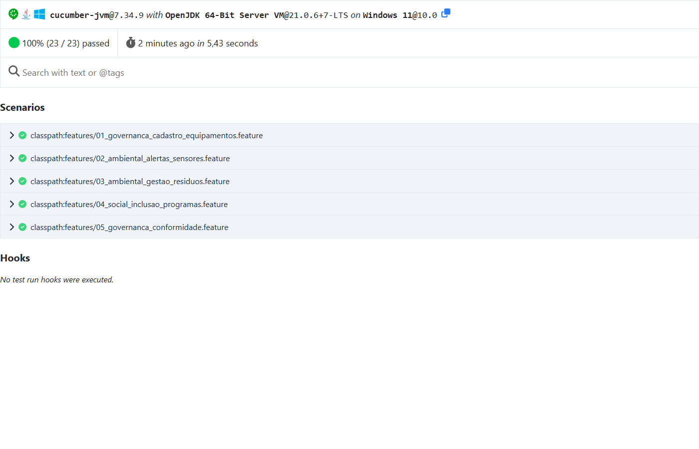
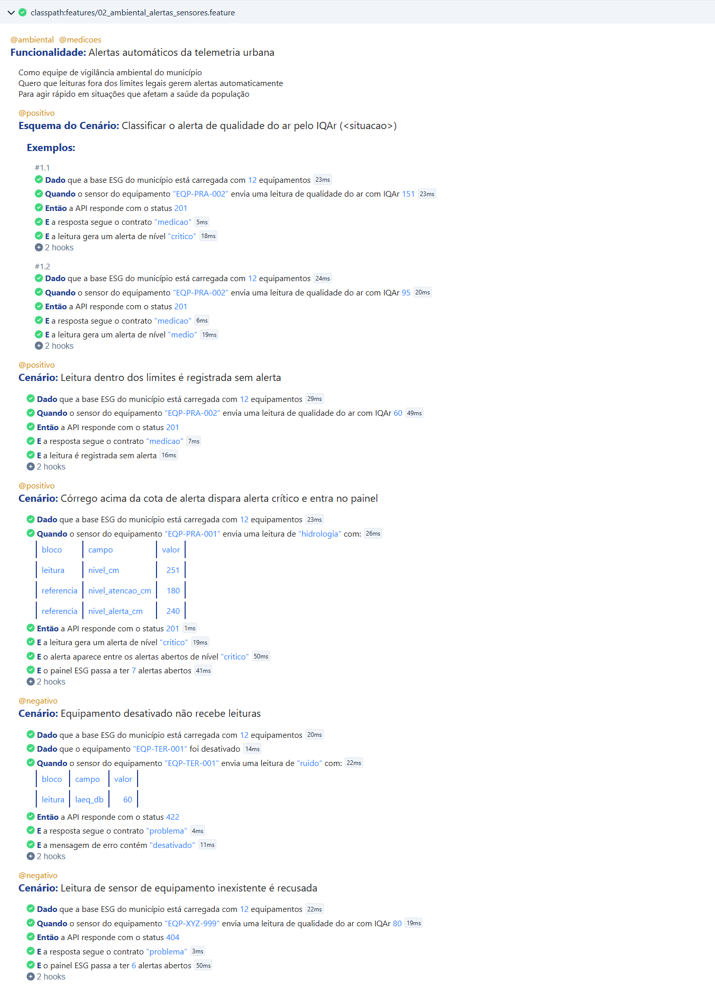
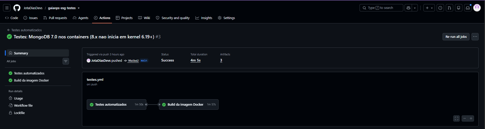
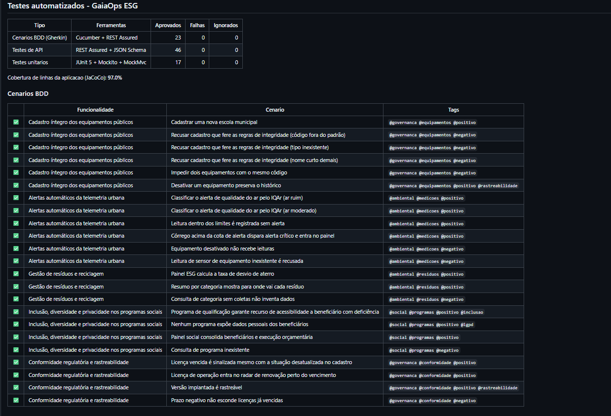

# GaiaOps ESG: testes automatizados (BDD + API)

[](https://github.com/JotaDiasDevs/gaiaops-esg-testes/actions/workflows/testes.yml)

FIAP · Fase *Testes Automatizados*

| Integrante | RM |
|---|---|
| João Victor Semente Dias | RM562065 |

---

## Sobre o projeto

O **GaiaOps ESG** é a API de gestão ESG do município fictício de **Vila Nova do Horizonte**, construída em Java 21 + Spring Boot 3.5 + MongoDB nas atividades anteriores. A API cobre:

| Pilar | Recursos da API |
|---|---|
| **E**: Ambiental | telemetria de sensores urbanos com **alertas automáticos** (qualidade do ar, ruído, água, córregos) e **gestão de resíduos e reciclagem** (coleta seletiva, desvio de aterro) |
| **S**: Social | programas sociais, **inclusão e acessibilidade**, beneficiários pseudonimizados (**LGPD**) |
| **G**: Governança | cadastro íntegro de equipamentos públicos, **licenças ambientais e prazos legais**, **rastreabilidade** da versão implantada |

Este repositório adiciona à aplicação uma suíte de testes automatizados que valida o comportamento crítico de cada pilar:

| Camada | Ferramentas | O que valida | Quantidade |
|---|---|---|---|
| **Cenários BDD** | Cucumber 7 + Gherkin (em português) + REST Assured | Comportamento de negócio de ponta a ponta, com caminhos felizes e de falha | 5 funcionalidades, **23 cenários** (9 negativos) |
| **Testes de API** | REST Assured + JSON Schema | **Todas as rotas da API**: status code, corpo JSON e contrato | **46 testes** em 7 classes |
| Testes unitários | JUnit 5 + Mockito + MockMvc | Regras de alerta e camada web isoladas | 17 testes |

Os cenários BDD e os testes de API sobem a **aplicação completa** num servidor HTTP real e usam um **MongoDB real**. Nada é simulado entre a API e o banco: a comunicação entre os serviços é exercitada de verdade.

---

## Cenários BDD (Gherkin)

Os arquivos ficam em [`src/test/resources/features/`](src/test/resources/features/), escritos em português (`# language: pt`) e marcados com o pilar ESG e o tipo de caminho (`@positivo` / `@negativo`).

| Funcionalidade | Pilar | Cenários positivos | Cenários negativos |
|---|---|---|---|
| [Cadastro íntegro dos equipamentos públicos](src/test/resources/features/01_governanca_cadastro_equipamentos.feature) | G | Cadastrar escola; desativar preservando o histórico | Código fora do padrão, tipo inexistente e nome curto (*Esquema do Cenário*); código duplicado |
| [Alertas automáticos da telemetria urbana](src/test/resources/features/02_ambiental_alertas_sensores.feature) | E | IQAr ruim → alerta crítico, IQAr moderado → alerta médio; leitura normal sem alerta; córrego na cota de alerta entra no painel | Equipamento desativado não recebe leitura (422); equipamento inexistente (404) |
| [Gestão de resíduos e reciclagem](src/test/resources/features/03_ambiental_gestao_residuos.feature) | E / S | Taxa de desvio de aterro; resumo por categoria e destinação | Categoria sem coletas não inventa dados |
| [Inclusão, diversidade e privacidade](src/test/resources/features/04_social_inclusao_programas.feature) | S | Recurso de acessibilidade para beneficiário com deficiência; **nenhum dado pessoal exposto (LGPD)**; painel social | Programa inexistente (404) |
| [Conformidade regulatória e rastreabilidade](src/test/resources/features/05_governanca_conformidade.feature) | G | Licença vencida sinalizada; licença no radar de renovação; versão implantada rastreável | Prazo negativo não esconde licença vencida |

Exemplo ([`02_ambiental_alertas_sensores.feature`](src/test/resources/features/02_ambiental_alertas_sensores.feature)):

```gherkin
# language: pt
@ambiental @medicoes
Funcionalidade: Alertas automáticos da telemetria urbana
  Como equipe de vigilância ambiental do município
  Quero que leituras fora dos limites legais gerem alertas automaticamente
  Para agir rápido em situações que afetam a saúde da população

  @positivo
  Esquema do Cenário: Classificar o alerta de qualidade do ar pelo IQAr (<situacao>)
    Quando o sensor do equipamento "EQP-PRA-002" envia uma leitura de qualidade do ar com IQAr <iqar>
    Então a API responde com o status 201
    E a resposta segue o contrato "medicao"
    E a leitura gera um alerta de nível "<nivel>"

    Exemplos:
      | situacao    | iqar | nivel   |
      | ar ruim     | 151  | critico |
      | ar moderado | 95   | medio   |

  @negativo
  Cenário: Equipamento desativado não recebe leituras
    Dado que o equipamento "EQP-TER-001" foi desativado
    Quando o sensor do equipamento "EQP-TER-001" envia uma leitura de "ruido" com:
      | bloco   | campo   | valor |
      | leitura | laeq_db | 60    |
    Então a API responde com o status 422
    E a resposta segue o contrato "problema"
    E a mensagem de erro contém "desativado"
```

As *step definitions* (o código que executa cada frase) ficam em [`src/test/java/br/com/fiap/gaiaops/bdd/`](src/test/java/br/com/fiap/gaiaops/bdd/).

---

## Testes de API

Ficam em [`src/test/java/br/com/fiap/gaiaops/api/`](src/test/java/br/com/fiap/gaiaops/api/). Cada teste faz uma **chamada HTTP real** e verifica três coisas:

1. **status code**;
2. **corpo da resposta (JSON)**: valores, quantidades, ordenação e efeitos colaterais, como uma gravação aparecer depois numa consulta;
3. **contrato (JSON Schema)**: a forma da resposta.

| Rota | Métodos | Status testados | Contrato |
|---|---|---|---|
| `/api/equipamentos` | GET (filtros, limite), POST | 200, 201, 400, 409, 422 | `equipamentos`, `equipamento`, `problema`, `problema-validacao` |
| `/api/equipamentos/{codigo}` | GET, PUT, DELETE | 200, 204, 400, 404 | `equipamento`, `problema`, `problema-validacao` |
| `/api/medicoes` | GET (filtros, limite), POST | 200, 201, 400, 404, 422 | `medicoes`, `medicao`, `problema`, `problema-validacao` |
| `/api/medicoes/alertas` | GET (nível, abertos) | 200 | `medicoes` |
| `/api/residuos` | GET (categoria) | 200 | `residuos` |
| `/api/residuos/resumo` | GET | 200 | `residuos-resumo` |
| `/api/programas-sociais` | GET (eixo) | 200 | `programas-sociais` |
| `/api/programas-sociais/{codigo}` | GET | 200, 404 | `programa-social`, `problema` |
| `/api/conformidade` | GET (tipo) | 200 | `conformidades` |
| `/api/conformidade/licencas/vencimentos` | GET (dias) | 200 | `licencas-vencimento` |
| `/api/indicadores` | GET | 200 | `painel-esg` |
| `/actuator/health`, `/readiness`, `/liveness`, `/actuator/info` | GET | 200 | `health`, `info` |
| `/v3/api-docs`, `/`, rota inexistente | GET | 200, 404 | `problema` |

**Garantia de cobertura:** o teste `PlataformaApiIT.cobreTodasAsRotas` lê a documentação OpenAPI da aplicação e compara com a lista de rotas cobertas pela suíte. Se alguém criar um endpoint novo sem teste, esse teste falha.

### Contratos JSON Schema

Os 17 contratos ficam em [`src/test/resources/schemas/`](src/test/resources/schemas/) e são validados com o módulo `json-schema-validator` do REST Assured. Alguns exemplos do que eles garantem:

- **`painel-esg.json`** é um contrato **fechado** (`additionalProperties: false`). Remover, renomear ou acrescentar um indicador quebra o teste, porque os consumidores do painel dependem exatamente desses campos.
- **`equipamento.json`** exige os campos de governança (código no padrão `EQP-XXX-NNN`, tipo do domínio, `ativo`, `criado_em`) e **aceita atributos livres** por tipo de equipamento, preservando o esquema flexível do MongoDB.
- **`programa-social.json`** **proíbe** `nome`, `cpf`, `rg`, `email` e `telefone` nos beneficiários: é uma regra da LGPD verificada em todo teste que lê programas sociais.
- **`problema.json`** e **`problema-validacao.json`** padronizam os erros no formato Problem Details (RFC 9457).

---

## Como executar os testes

**Pré-requisitos:** JDK 21. O Maven não precisa estar instalado, porque o projeto traz o Maven Wrapper (`mvnw`). Além disso, você precisa de **um** destes:
- **Docker** em execução (opção A, recomendada): o MongoDB sobe sozinho num container;
- **MongoDB** instalado (opção B), para máquinas sem Docker.

### Opção A: com Docker (igual ao pipeline)

```bash
./mvnw verify
```

O Testcontainers sobe um `mongo:8.0` descartável, roda tudo e remove o container no final.

### Opção B: com um MongoDB local

Aponte os testes para um banco **descartável**. Por segurança, o nome do banco precisa conter "teste", porque os testes apagam e recarregam as collections a cada cenário.

```bash
# Linux / macOS / Git Bash
export TEST_MONGODB_URI="mongodb://localhost:27017/gaiaops_testes"
./mvnw verify
```

```powershell
# Windows PowerShell
$env:TEST_MONGODB_URI = "mongodb://localhost:27017/gaiaops_testes"
.\mvnw.cmd verify
```

### Executar só uma parte

| Objetivo | Comando |
|---|---|
| Só os testes unitários | `./mvnw test` |
| Só cenários BDD e testes de API | `./mvnw verify -DskipUnitTests=true` |
| Só os cenários BDD | `./mvnw verify -DskipUnitTests=true -Dit.test=CucumberIT` |
| Só os cenários de um pilar ou tipo | `./mvnw verify -DskipUnitTests=true -Dit.test=CucumberIT "-Dcucumber.filter.tags=@negativo"` (ou `@social`, `@governanca and @positivo`…) |
| Só os testes de uma API | `./mvnw verify -DskipUnitTests=true -Dit.test=MedicaoApiIT` |

> No Windows, rode `chcp 65001` antes para ver os acentos dos cenários corretamente no terminal. Os relatórios não são afetados.

### Relatórios gerados

| Arquivo | Conteúdo |
|---|---|
| `target/cucumber-reports/cucumber.html` | **Relatório navegável do Cucumber**: cada cenário com seus passos, resultado e tempo |
| `target/cucumber-reports/cucumber.json` / `cucumber.xml` | Mesmo resultado para ferramentas de CI |
| `target/failsafe-reports/` e `target/surefire-reports/` | Resultado JUnit dos testes de API e unitários |
| `target/site/jacoco/index.html` | Cobertura de código da aplicação (**97,6% das linhas** na execução local) |

Para ver um resumo em tabelas no terminal: `python3 .github/scripts/resumo_testes.py`.

### Como os testes isolam os dados

- **Antes de cada cenário e de cada teste**, a base volta ao estado da carga inicial (os 100 documentos do município). Nenhum teste depende da ordem nem dos dados de outro.
- **O relógio da aplicação é controlado:** a data fica fixa em 01/10/2026, e um cenário pode ajustá-la (*"Dado que a data de referência é 01/09/2027"*). Assim, regras como "licença vencida há 16 dias" têm resultado estável em qualquer dia de execução.

---

## Pipeline de CI (GitHub Actions)

O workflow [`.github/workflows/testes.yml`](.github/workflows/testes.yml) roda em todo push e pull request na `main` e também sob demanda (**Actions → Testes automatizados → Run workflow**):

| Etapa | O que faz |
|---|---|
| 1. Testes unitários | `./mvnw test` |
| 2. Cenários BDD e testes de API | `./mvnw verify -DskipUnitTests=true`: API real + MongoDB 8.0 em container (Testcontainers) |
| 3. Resumo da execução | Tabelas com cada cenário, cada classe de API e a cobertura, na página da execução |
| Artefatos | `relatorio-cucumber` (HTML) e `relatorios-junit-e-cobertura` |
| Build da imagem Docker | Confirma que o `Dockerfile` continua funcional |

> Os jobs rodam em `ubuntu-24.04`, e não em `ubuntu-latest`. Desde 19/10/2026 o `ubuntu-latest` é o Ubuntu 26, cujo kernel (6.19+) é incompatível com o MongoDB 8.x ([SERVER-121912](https://jira.mongodb.org/browse/SERVER-121912)): o `mongod` se recusa a iniciar. Fixar o runner mantém os testes no mesmo MongoDB 8.0 usado pela aplicação.

---

## Executar a aplicação (opcional)

Para explorar a API manualmente, por exemplo pelo Swagger:

```bash
cp .env.example .env            # e troque as senhas
docker compose up -d --build    # API + MongoDB
```

Depois abra http://localhost:8080 (painel) ou http://localhost:8080/swagger-ui.html (documentação). Sem Docker, com um MongoDB local: `./mvnw spring-boot:run`.

---

## Evidências

Os prints estão em [`docs/prints/`](docs/prints/), e o log completo da execução local em [`docs/evidencias/`](docs/evidencias/).

### Execução local: relatório do Cucumber (23/23 cenários aprovados)



### Execução no GitHub Actions



---

## Bug real encontrado pelos testes

Na primeira execução, os testes de API mostraram que o mapa de `erros` das respostas de validação usava o **nome do atributo Java** (`populacaoAtendida`, `equipamentoId`) em vez do **nome do campo no JSON** (`populacao_atendida`, `equipamento_id`). O cliente enviava um campo e recebia o erro apontando para outro nome, que não existe no contrato da API.

A correção foi feita em [`TratadorDeErros`](src/main/java/br/com/fiap/gaiaops/comum/TratadorDeErros.java), que agora traduz o nome usando a mesma estratégia de nomes do Jackson. Um teste unitário novo (`errosDeValidacaoUsamOsNomesDeCampoDoJson`) impede a regressão.

---

## Tecnologias

Java 21 · Spring Boot 3.5 · MongoDB 8.0 · **Cucumber 7 (Gherkin)** · **REST Assured 5** · **JSON Schema Validator** · JUnit 5 (Platform Suite) · Testcontainers · Mockito · JaCoCo · Maven Wrapper · Docker / Docker Compose · GitHub Actions

---

## Estrutura

```
gaiaops-esg-testes/
├── .github/
│   ├── workflows/testes.yml              pipeline de testes
│   └── scripts/resumo_testes.py          resumo da execução (tabelas)
├── src/main/...                          aplicação (API GaiaOps ESG)
├── src/test/
│   ├── java/br/com/fiap/gaiaops/
│   │   ├── bdd/                          runner do Cucumber + step definitions
│   │   ├── api/                          testes de API (*ApiIT)
│   │   ├── suporte/                      MongoDB de teste, relógio, restauração da base, contratos
│   │   ├── equipamento/, medicao/        testes unitários
│   └── resources/
│       ├── features/                     cenários BDD em Gherkin (.feature)
│       └── schemas/                      contratos JSON Schema
├── docs/                                 documentação (PDF), prints e evidências
├── Dockerfile, docker-compose.yml, mongo/init/   execução da aplicação em containers
├── .env.example
└── README.md
```
